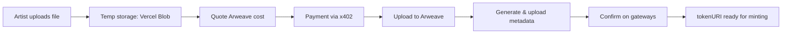

# @cryptoart/media

Media backend for lazy minting with Arweave permanence.

## Overview

This package provides a complete media upload pipeline for artists to upload artwork before minting NFTs. The flow:

1. **Temporary upload** → Artist uploads media to Vercel Blob storage
2. **Quote & payment** → System quotes Arweave storage cost in USDC
3. **Permanent storage** → After payment, media is uploaded to Arweave via ArDrive Turbo
4. **Metadata generation** → ERC-721/1155 compatible JSON metadata is created and uploaded
5. **Gateway confirmation** → System verifies media is retrievable from multiple Arweave gateways



## Environment Variables

| Variable | Required | Description |
|----------|----------|-------------|
| `TURBO_PRIVATE_KEY` or `ARWEAVE_JWK` | Production only | Arweave wallet private key (JWK format). Leave unset in dev to use simulated Arweave. Same key works for both Turbo and direct L1 uploaders. |
| `ARWEAVE_UPLOADER` | Optional | Uploader type: `turbo` (default, ArDrive paid service) or `direct` (L1, stub). Ignored if no key is set. |
| `BLOB_READ_WRITE_TOKEN` | Yes | Vercel Blob storage token for temporary uploads |
| `POSTGRES_URL` | Yes | Database connection string |
| `CRYPTOART_MEDIA_PAY_TO` | Yes | Wallet address to receive upload payments |
| `CRYPTOART_MEDIA_NETWORK` | Optional | Payment network (default: `eip155:84532` in dev, `eip155:8453` in prod) |
| `CRYPTOART_MEDIA_ASSET` | Optional | Payment asset address (USDC by default) |
| `CRYPTOART_MEDIA_ALLOW_MOCK_PAYMENT` | Optional | Allow mock payment headers (default: true in dev, false in prod) |
| `CRYPTOART_MEDIA_MAX_FILE_SIZE` | Optional | Max file size in bytes (default: 104857600 = 100 MB) |
| `CRYPTOART_MEDIA_TEMP_TTL_SECONDS` | Optional | Temp upload expiration in seconds (default: 3600 = 1 hour) |
| `X402_FACILITATOR_URL` | Optional | External payment facilitator URL. Falls back to mock facilitator if unset. |

### Key Policy

**Never commit private keys.** The `TURBO_PRIVATE_KEY` or `ARWEAVE_JWK` is meant to be added via environment variables in production (e.g., Vercel dashboard secrets). The key should control a dedicated wallet that only holds Arweave upload credits, not production funds.

Without a key, the system falls back to **simulated Arweave** for local development and testing. Simulated uploads work end-to-end but don't hit the real Arweave network.

### Arweave Uploader Interface

The media backend abstracts the Arweave upload mechanism behind an `ArweaveAdapter` interface. This allows swapping between different upload strategies without touching callers:

- **Turbo uploader** (`createTurboArweave`) - ArDrive paid service, credit-based, fast (default)
- **Direct L1 uploader** (`createDirectArweave`) - Direct Arweave network uploads via arweave-js (stub implementation, requires adding arweave-js dependency and completing the implementation)
- **Simulated uploader** (`createSimulatedArweave`) - In-memory mock for local dev and tests

All uploaders use the same JWK format for wallet compatibility. Set `ARWEAVE_UPLOADER=direct` to use the direct L1 uploader (when implemented).

### Temporary Upload Expiration

Temporary uploads to Vercel Blob expire after `CRYPTOART_MEDIA_TEMP_TTL_SECONDS` (default: 1 hour). Artists should finalize their upload job within this window. After expiration, the temp file is automatically cleaned up by Vercel Blob's TTL policy. This prevents abandoned uploads from consuming storage indefinitely.

## API Routes

All routes are authenticated via wallet session (SIWE). The payer address is extracted from the session.

### `GET /api/media/config`

Get media backend configuration (max file size, uploader type, temp TTL, etc.). Use this to show cost preview and validate file size before upload.

**Response:**
```json
{
  "allowMockPayment": true,
  "hasTurbo": true,
  "hasFacilitator": false,
  "network": "eip155:84532",
  "uploaderType": "turbo",
  "maxFileSize": 104857600,
  "maxFileSizeMB": 100,
  "tempUploadTtlSeconds": 3600
}
```

### `POST /api/media/temp-upload`

Upload a file to temporary storage (Vercel Blob). Returns a signed URL with expiration time. Check `/api/media/config` for `maxFileSize` before calling to avoid rejection.

**Request:**
- `Content-Type: multipart/form-data`
- `file`: File to upload (max configurable, default 100 MB)
- Supported types: images, video, audio, HTML/3D

**Response:**
```json
{
  "url": "https://blob.vercel-storage.com/...",
  "pathname": "temp/abc123.png",
  "size": 1234567,
  "contentType": "image/png",
  "expiresAt": "2026-11-13T09:25:00.000Z"
}
```

### `POST /api/media/quote`

Get a quote for uploading files to Arweave.

**Request:**
```json
{
  "files": [{
    "name": "artwork.png",
    "mimeType": "image/png",
    "size": 1234567,
    "sha256": "abc123..."
  }],
  "idempotencyKey": "optional-client-key"
}
```

**Response (402 Payment Required):**
```json
{
  "quote": {
    "idempotencyKey": "generated-or-provided-key",
    "files": [...],
    "byteCount": 1234567,
    "arweaveWinston": "123456789000",
    "usdcAmount": "50000",
    "asset": "0x833589fCD6eDb6E08f4c7C32D4f71b54bdA02913",
    "network": "eip155:8453",
    "payTo": "0x...",
    "expiresAt": "2026-11-13T09:00:00.000Z",
    "safetyMarginBps": 500
  },
  "x402Version": 2,
  "error": "Payment required",
  "accepts": [...]
}
```

### `POST /api/media/jobs`

Create a paid upload job. Requires payment via x402 header or mock payment header.

**Request:**
```json
{
  "idempotencyKey": "quote-key",
  "paymentHeader": "mock:allow"
}
```

**Headers:**
- `X-Payment` (alternative to body.paymentHeader): Payment proof

**Response (201 Created):**
```json
{
  "job": {
    "id": "uuid",
    "status": "paid",
    "payerAddress": "0x...",
    "quote": {...},
    "payment": {...},
    ...
  }
}
```

### `POST /api/media/jobs/:id/media`

Upload the media file bytes to Arweave.

**Request:**
```json
{
  "bytes": "base64-encoded-file"
}
```

**Response:**
```json
{
  "job": {
    "id": "uuid",
    "status": "uploading_metadata",
    "media": {
      "id": "arweave-tx-id",
      "sha256": "...",
      "mimeType": "image/png",
      "size": 1234567,
      "gateways": []
    },
    ...
  },
  "simulated": false
}
```

### `POST /api/media/jobs/:id/metadata`

Generate and upload ERC-721/1155 metadata JSON.

**Request:**
```json
{
  "name": "Artwork Title",
  "description": "Optional description",
  "attributes": [
    { "trait_type": "Style", "value": "Abstract" }
  ],
  "animation_url": "ar://..."
}
```

**Response:**
```json
{
  "job": {
    "id": "uuid",
    "status": "confirming",
    "metadata": {
      "id": "arweave-metadata-tx-id",
      "sha256": "...",
      "mimeType": "application/json",
      "size": 456,
      "gateways": []
    },
    ...
  },
  "metadata": {
    "name": "Artwork Title",
    "description": "",
    "image": "ar://arweave-media-tx-id",
    "attributes": [...],
    "content": {
      "uri": "ar://...",
      "mime": "image/png",
      "hash": "sha256:...",
      "width": null,
      "height": null
    }
  }
}
```

### `POST /api/media/jobs/:id/confirm`

Confirm that media and metadata are retrievable from Arweave gateways.

**Response:**
```json
{
  "job": {
    "id": "uuid",
    "status": "confirmed",
    "media": {
      "id": "...",
      "gateways": ["https://arweave.net", "https://ar-io.net"]
    },
    "metadata": {
      "id": "...",
      "gateways": ["https://arweave.net", "https://ar-io.net"]
    },
    "confirmation": {
      "mediaOk": true,
      "metadataOk": true,
      "checkedAt": "2026-11-13T08:30:00.000Z"
    },
    ...
  },
  "mintEnabled": true
}
```

### `GET /api/media/jobs/:id`

Get current job status.

## Job Status State Machine

```
quoted → paid → uploading_media → uploading_metadata → confirming → confirmed
           ↓
      failed / credit_owed / refunded
```

- **quoted**: Quote generated, payment pending
- **payment_required**: Same as quoted (402 response)
- **paid**: Payment received and verified
- **uploading_media**: Media upload in progress
- **uploading_metadata**: Metadata upload in progress
- **confirming**: Checking gateway retrieval
- **confirmed**: Successfully uploaded and verified (mint enabled)
- **failed**: Upload failed before payment
- **credit_owed**: Upload failed after payment (user owes refund/credit)
- **refunded**: Credit issued

## Cost Notes

Arweave storage costs are calculated based on file size:

- ~100,000 winston per byte (base cost)
- 5% safety margin applied by default
- Converted to USDC at ~$8 per AR (market rate may vary)
- Minimum charge: $0.01 USDC

**Example costs** (approximate, not guaranteed):
- 1 MB image: ~$0.80 USDC
- 10 MB video: ~$8.00 USDC
- 50 MB high-res video: ~$40.00 USDC

Costs are paid in USDC on Base (mainnet) or Base Sepolia (testnet). The payment flow uses the x402 protocol for on-chain settlement.

## Client Library

```typescript
import { MediaClient } from '@cryptoart/media/client';

const client = new MediaClient({
  baseUrl: '/api/media',
  fetch: window.fetch.bind(window)
});

// 0. Get config and show cost estimate
const config = await client.getConfig();
if (file.size > config.maxFileSize) {
  alert(`File too large. Max: ${config.maxFileSizeMB} MB`);
  return;
}
const estimatedCost = client.estimateCost(file.size);
console.log(`Estimated cost: $${estimatedCost} USDC`);

// 1. Upload to temp storage
const tempFile = await client.uploadTemp(file);
console.log(`Temp file expires at: ${tempFile.expiresAt}`);

// 2. Get quote
const { quote } = await client.quote([{
  name: file.name,
  mimeType: file.type,
  size: file.size,
  sha256: await client.hashFile(file)
}]);

// 3. Pay and create job
const { job } = await client.createJob(quote.idempotencyKey, 'mock:allow');

// 4. Upload media
const { job: withMedia } = await client.uploadMedia(job.id, fileBytes);

// 5. Upload metadata
const { job: withMetadata } = await client.uploadMetadata(job.id, {
  name: 'My Artwork',
  description: 'Description',
  attributes: [{ trait_type: 'Color', value: 'Blue' }]
});

// 6. Confirm
const { job: confirmed } = await client.confirm(job.id);

console.log('Token URI:', `ar://${confirmed.job.metadata.id}`);
```

## Testing

```bash
pnpm test
```

Tests cover:
- Status state machine transitions
- Payment idempotency
- Media and metadata upload flow
- Gateway confirmation
- Post-payment failure handling (credit_owed)
- Mock payment restrictions

## Database Schema

See `packages/db/migrations/0026_identity_editorial_media.sql` and `0029_arweave_records.sql` for the full schema.

**Tables:**
- `upload_jobs` - Main job records with status and JSONB payloads
- `payment_receipts` - Payment verification records
- `arweave_records` - Canonical Arweave transaction records (media + metadata)

## Integration with Lazy Minting

When a collection contract implements `ILazyDelivery` and the auction house calls `deliver()` at settlement:

1. Artist creates a listing with `tokenURI` set to `ar://{metadata.id}` from a confirmed upload job
2. Auction happens off-chain (lazy listing)
3. At settlement, auction house calls `deliver(tokenId, winner, tokenURI, ...)`
4. Contract mints token with the preset `tokenURI`

The media backend is decoupled from the collection contracts. It only provides the `tokenURI` that the artist presets before any sale.
